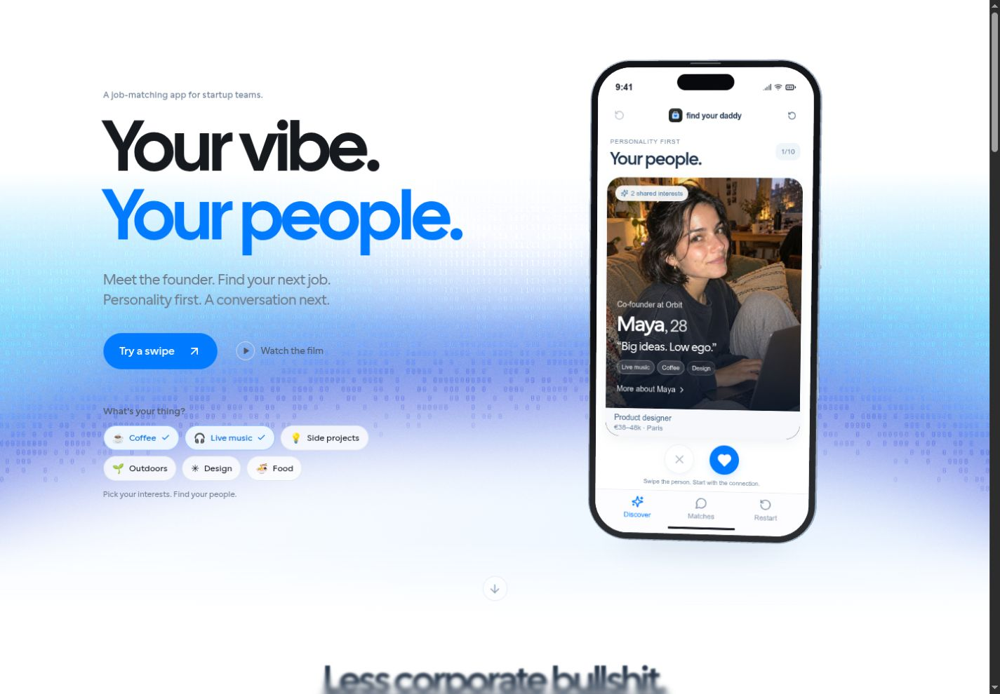
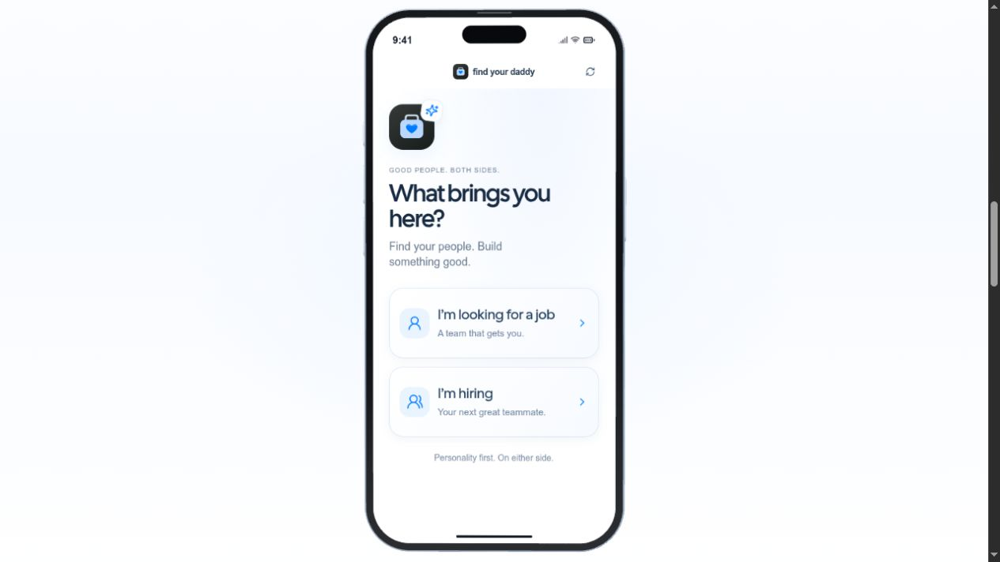
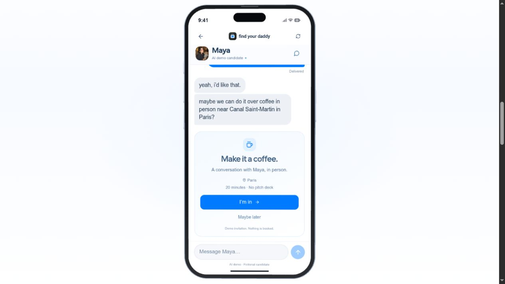

# Find Your Daddy

**Stop applying. Start matching.**

A personality-first job-matching web prototype connecting early-career talent with founders and small startup teams. Shared interests and working style start the conversation; skills add the context.

**[Open the app → fyd.kepard.dev](https://fyd.kepard.dev)** · Built for [DevDay Exchange Community: Paris](https://luma.com/6nccj7gu).



## The experience

- Choose your side: looking for a job or hiring.
- Set your interests and working style, then complete CV or role onboarding.
- Swipe through profiles, explore compatibility, and connect after a mutual match.
- Chat with AI-powered personas in short, natural messages, then take the conversation toward coffee in person.

The prototype runs in the browser with an iOS-inspired interface. Native iOS and Android apps are not available yet.

| Onboarding | Conversation |
| --- | --- |
|  |  |

## Run locally

Requires **Node.js 22.13+**.

```sh
git clone https://github.com/Kepard/devday-paris-hackathon.git
cd devday-paris-hackathon
npm ci
npm run dev
```

Open **http://localhost:5173**. To enable AI replies, copy `.env.example` to `.env`, add your own OpenAI API key and a future expiry date, then restart. Without a key, the complete flow remains usable with built-in conversation responses.

`npm test` runs the backend checks. `npm run build && npm start` serves the built app locally.

## Team

**Gérardo AMOUZOUVI · Vibol Arnaud Sok · Bogdan Gorelov**

React · Vite · Motion · Three.js · Node.js · SQLite · OpenAI API

[Design and asset credits](docs/CREDITS.md)
